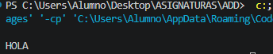
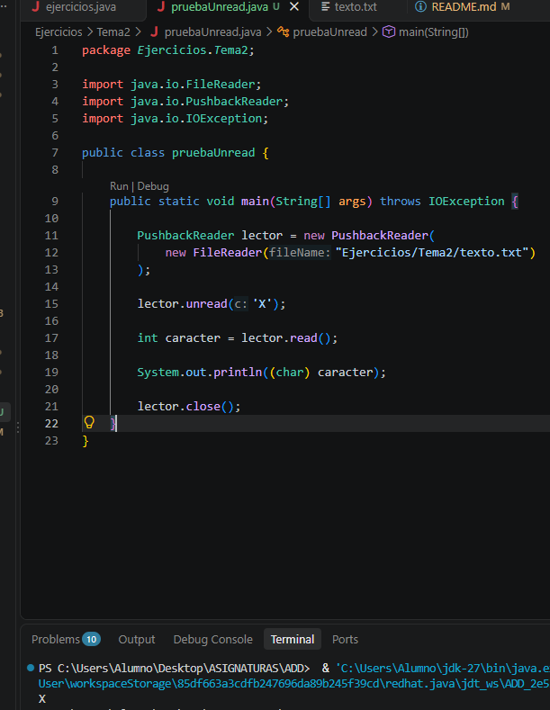
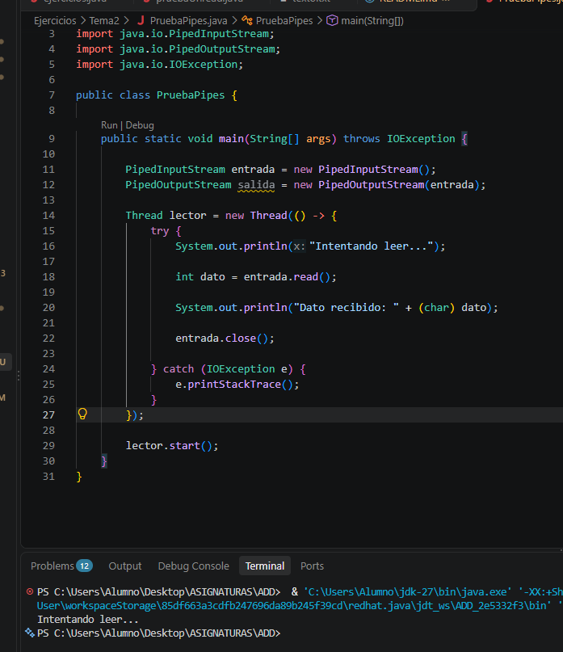
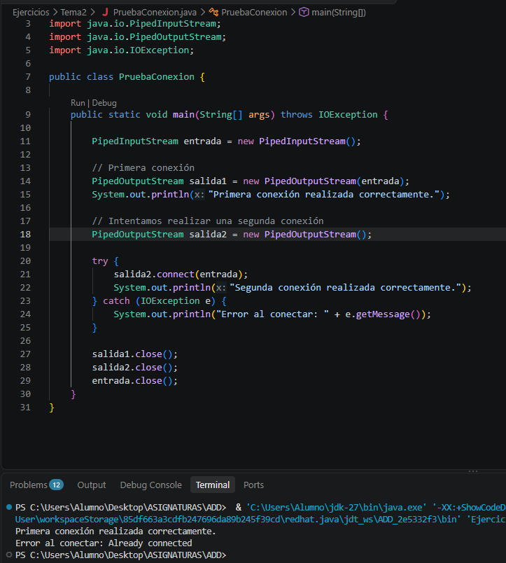
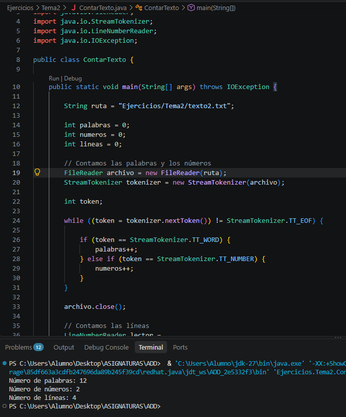
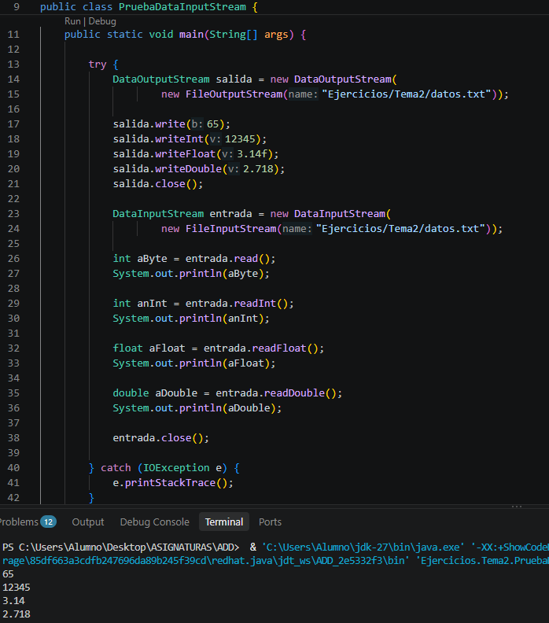
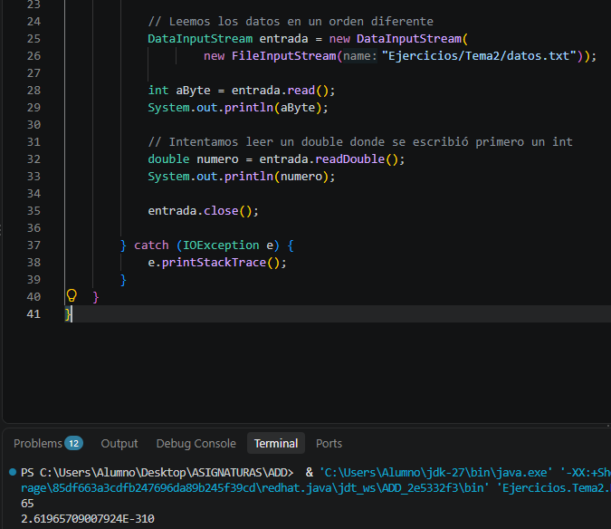

# 1. PushbackReader

## ¿El uso de read modifica el archivo?

No. El método `read()` lee caracteres del archivo, pero no modifica su contenido. Lo que cambia es la posición de lectura dentro del flujo.

## ¿Utilizando read(), puedo leer más de un carácter?

Sí. El método `read()` permite leer más de un carácter realizando varias llamadas. Cada llamada lee un carácter y devuelve `-1` cuando se alcanza el final del archivo. Mediante un bucle `while`, podemos leer todo el contenido del archivo carácter por carácter.

## ¿Qué ocurre si hago unread() sin leer previamente un carácter?

El método `unread()` permite introducir un carácter en el búfer de retroceso sin necesidad de haberlo leído previamente del archivo. Por ejemplo, si ejecutamos `unread('X')` y después llamamos a `read()`, se leerá primero la letra `X`, aunque no estuviera en el archivo original.

Sin embargo, si el búfer está lleno y se intenta introducir otro carácter, se producirá una excepción `IOException`.

# 2. PipedInputStream y PipedOutputStream

## ¿Qué ocurre si intentas leer antes de que se haya escrito nada?

Si intentamos leer de un `PipedInputStream` antes de que se haya escrito ningún dato, el método `read()` se queda bloqueado esperando a que haya información disponible. Cuando otro hilo escribe datos en el `PipedOutputStream` conectado, la lectura continúa y recibe esos datos.

Por tanto, la lectura no devuelve inmediatamente un resultado vacío, sino que espera hasta que haya datos disponibles o se produzca alguna condición que provoque una excepción.

## ¿Se puede conectar un PipedInputStream con varios PipedOutputStream?

No. Un `PipedInputStream` solo puede estar conectado a un `PipedOutputStream` a la vez. Si intentamos conectar un segundo `PipedOutputStream` al mismo flujo de entrada cuando ya está conectado, se producirá una excepción `IOException`.

## Ejercicio 3: Contar palabras, números y líneas de un archivo

### Objetivo

Crear un programa en Java que lea un archivo de texto y cuente:
- Cuántas palabras contiene.
- Cuántos números aparecen.
- Cuántas líneas se han procesado.

### Archivo de entrada

El archivo `texto2.txt` contiene el siguiente texto:

    Hola
    Tengo 29 años
    Java tiene 25 años
    Tengo mas años que el sol.

### Código Java

El programa utiliza `StreamTokenizer` para contar las palabras y los números, y `LineNumberReader` para contar las líneas.

### Resultado esperado

    Número de palabras: 12
    Número de números: 2
    Número de líneas: 4

### Explicación

- **StreamTokenizer:** analiza el texto y distingue entre palabras y números.
- **nextToken():** obtiene el siguiente elemento del archivo hasta llegar al final.
- **TT_WORD:** identifica una palabra.
- **TT_NUMBER:** identifica un número.
- **TT_EOF:** indica que se ha llegado al final del archivo.
- **LineNumberReader:** permite leer el archivo línea por línea.
- **close():** cierra los lectores cuando terminan de utilizarse.

### Captura de la ejecución

## Ejercicio 4: DataInputStream

### ¿Qué ocurre si lees los datos en un orden distinto al que fueron escritos?

`DataInputStream` permite leer datos primitivos de Java, como `int`, `double`, `boolean` o `char`.

Los datos deben leerse en el mismo orden y utilizando métodos compatibles con los que se usaron para escribirlos. Si se leen en un orden diferente, se pueden obtener valores incorrectos o producirse resultados inesperados.

Por ejemplo, si se escribe primero un número entero con `writeInt()` y después un número decimal con `writeDouble()`, hay que utilizar primero `readInt()` y después `readDouble()` para recuperar correctamente los datos.

### Capturas de la ejecución

**1. Funcionamiento correcto (lectura en el mismo orden en que se escribieron los datos)**

**2. Lectura en un orden diferente (resultado incorrecto)**

