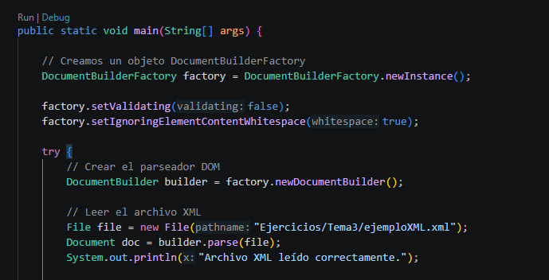

# Práctica DOM y XPath

Lectura y procesamiento de un archivo XML en Java utilizando DOM y XPath.

## Código

Capturas del código de `parseadordom.java`.

## Resultado

Captura de la ejecución del programa.