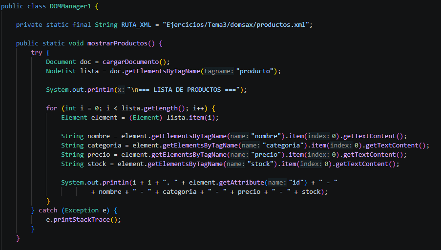
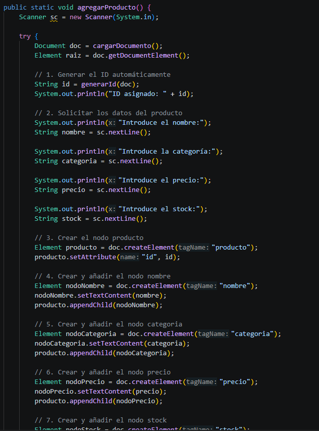
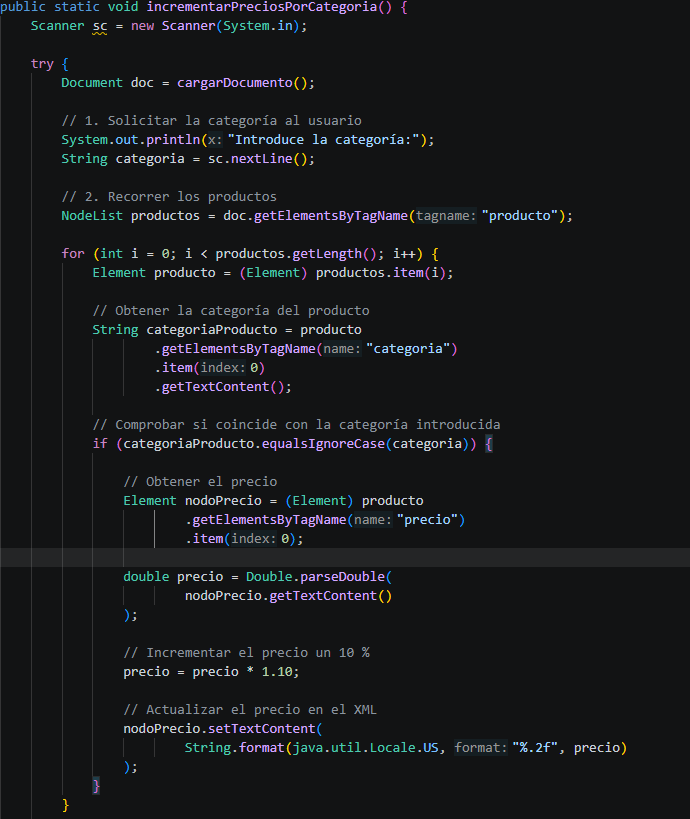
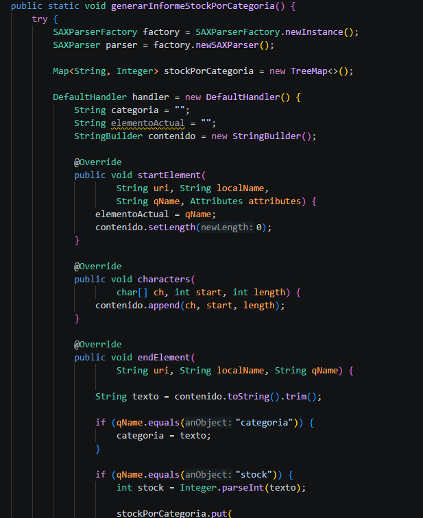
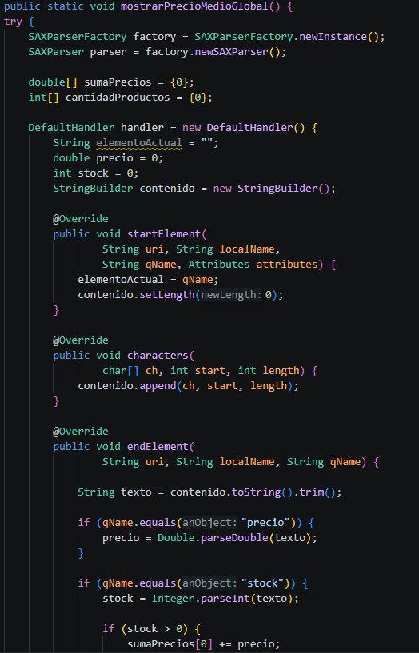

# Práctica DOM y SAX

## 1. Mostrar todos los productos (DOM)

## 2. Añadir un nuevo producto (DOM)

## 3. Incrementar precios de una categoría (DOM)

## 4. Generar informe de stock por categoría (SAX)

## 5. Mostrar precio medio global (SAX)

